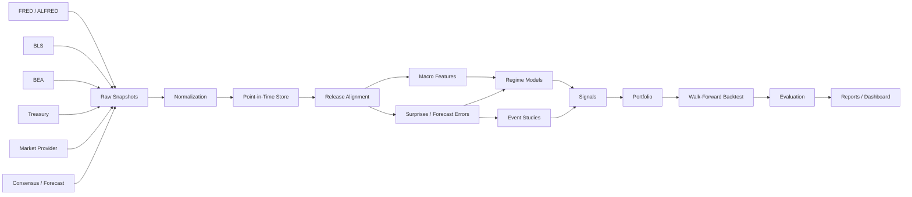

# MacroSignal Architecture

## Boundaries

### Data Layer
Only source adapters know external API schemas.

### PIT Layer
Owns as-of reconstruction and availability checks.

### Feature Layer
Owns transformations and training-only preprocessing.

### Regime Layer
Owns macro-state models and contemporaneous probabilities.

### Research Layer
Owns event studies and signal construction.

### Portfolio Layer
Owns weights, constraints, and risk scaling.

### Backtest Layer
Owns chronology, execution, turnover, costs, and benchmarks.

### Reporting Layer
Reads immutable result artifacts; it does not recompute research silently.

## Storage

Recommended v1:
- raw source payloads: files / compressed JSON/CSV where permitted,
- normalized tables: Parquet,
- metadata/manifests: JSON,
- local research registry: SQLite or Parquet manifest tables.

Do not require a distributed database for v1.

## Artifact Registry (Task 1.10)

`macrosignal.artifacts.ArtifactRegistry(data_dir, reports_dir)` stores every
artifact at a deterministic path and records it in the append-only, git-ignored
registry `data/registry/artifacts.jsonl`:

| Kind | Path |
|---|---|
| `raw_snapshot` | `data/raw/<source>/<artifact_id>/` |
| `normalized` | `data/processed/normalized/<artifact_id>/` |
| `pit_snapshot` | `data/snapshots/pit/<artifact_id>/` |
| `features` | `data/processed/features/<artifact_id>/` |
| `model_fit` | `data/processed/model_fits/<artifact_id>/` |
| `backtest` | `reports/runs/<artifact_id>/backtest/` |
| `report` | `reports/runs/<artifact_id>/report/` |

Each record stores kind, path, sorted file list, a content hash over
(file path, sha256) pairs, and optional `source`, `run_id`, `snapshot_id`,
`model_fit_id` and metadata. Ids and file names are restricted to safe
characters (no path traversal). Artifacts are immutable: re-registering the
same id with identical content is a no-op, different content or kind raises
`ImmutableArtifactError`, and pre-existing unregistered directories are never
overwritten. Files are written to a staging directory and moved into place.
Lookups: `get(artifact_id)`, `by_run`, `by_snapshot`, `by_model_fit`; `verify`
recomputes the content hash to detect tampering.
