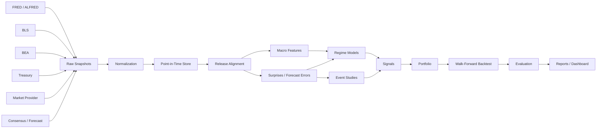

# MacroSignal Architecture

## Boundaries

### Data Layer
Only source adapters know external API schemas.

### PIT Layer
Owns as-of reconstruction and availability checks.

### Feature Layer
Owns transformations and training-only preprocessing.

### Regime Layer
Owns macro-state models and contemporaneous probabilities.

### Research Layer
Owns event studies and signal construction.

### Portfolio Layer
Owns weights, constraints, and risk scaling.

### Backtest Layer
Owns chronology, execution, turnover, costs, and benchmarks.

### Reporting Layer
Reads immutable result artifacts; it does not recompute research silently.

## Storage

Recommended v1:
- raw source payloads: files / compressed JSON/CSV where permitted,
- normalized tables: Parquet,
- metadata/manifests: JSON,
- local research registry: SQLite or Parquet manifest tables.

Do not require a distributed database for v1.
